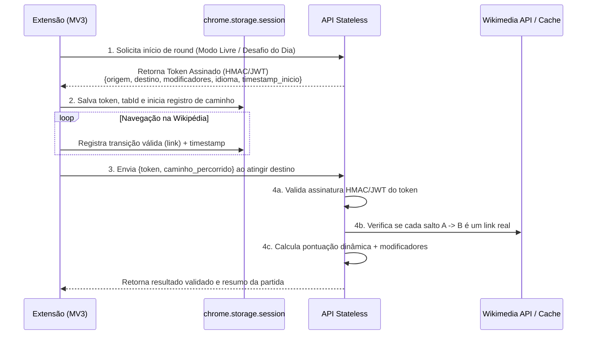

# 🏗️ Arquitetura Stateless & Validação Unificada

> **Decisão Arquitetural da V1:** Sem contas de usuário, sem banco de dados persistente na V1 e **partidas 100% stateless**. Todos os modos — inclusive o **Modo Livre** — passam pelo mesmo pipeline de validação na API.

---

## 🔄 Fluxo Stateless da Partida

### 1. Início do Round
- A API sorteia artigo de origem, artigo de destino e modificadores do round (ou gera de forma determinística no **Desafio do Dia** usando `YYYY-MM-DD` + `idioma`).
- A API retorna um **token assinado** (HMAC/JWT) contendo:
  - `origem`
  - `destino`
  - `modificadores`
  - `idioma`
  - `timestamp_inicio`
- Nada é salvo no banco de dados ou memória do servidor.

### 2. Durante o Round (Extensão Manifest V3)
- Como o Service Worker do navegador no Manifest V3 é encerrado após ~30 segundos sem atividade, o estado da partida ativa fica armazenado localmente em `chrome.storage.session`.
- A extensão monitora a aba ativa da partida (`tabId`) e registra apenas navegações válidas do tipo `link` com seus respectivos timestamps.

### 3. Finalização e Validação
- Ao chegar no artigo objetivo, a extensão envia `{ token, caminho_percorrido }` para o endpoint de validação da API.

### 4. Cálculo e Anti-Cheat no Servidor
- A API valida a assinatura criptográfica do token.
- Verifica se cada salto `A -> B` no `caminho_percorrido` corresponde a um link real na Wikipédia (consultando a MediaWiki API ou um cache/grafo local).
- Calcula a pontuação final aplicando os multiplicadores de tempo, cliques e modificadores do round.

---

## ⚔️ Arquitetura para PvP 1v1 (Fase 2)

- **Sem banco persistente:** O modo PvP 1v1 em salas privadas não requer banco de dados persistente, mas exige **estado efêmero de sala** durante a partida ativa.
- **Dados efêmeros da sala:**
  - Código/link da sala;
  - Jogadores conectados;
  - Início sincronizado da partida (mesmo token/desafio);
  - Estado de conclusão e determinação do vencedor.
- **Opções de implementação:**
  - Em memória (caso rode em instância única);
  - Serviço realtime / pub-sub efêmero (ex.: Redis, Cloudflare Durable Objects ou WebRTC).
